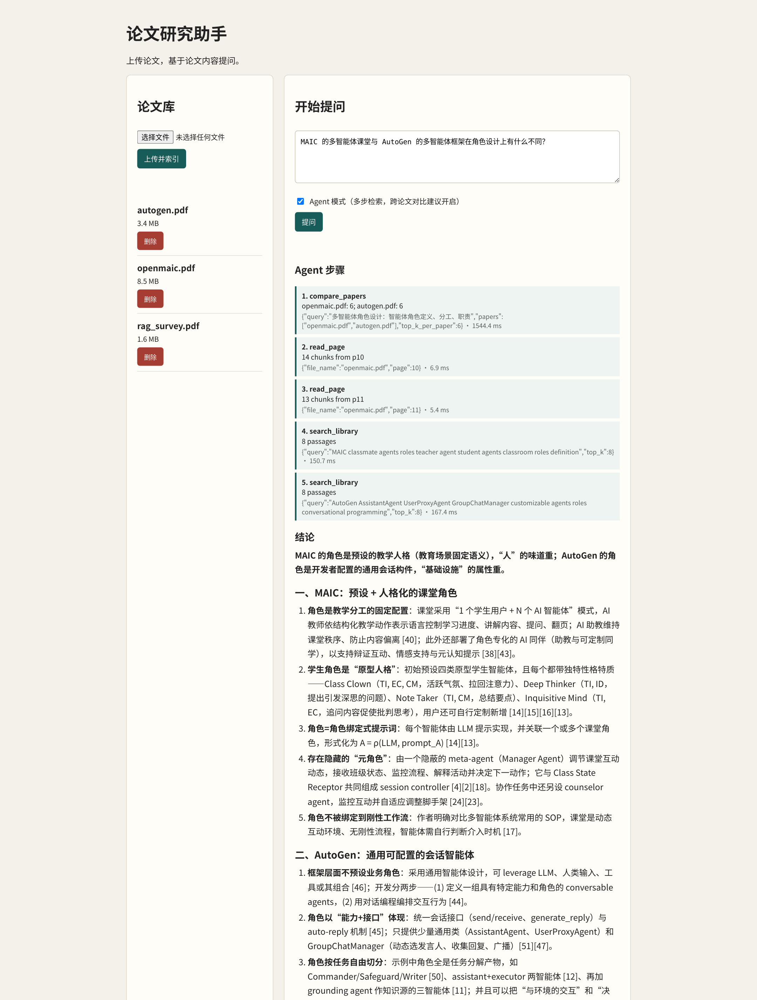
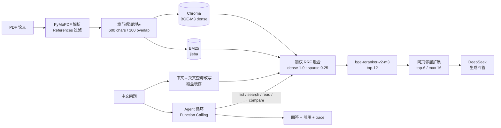

# Paper Research Agent

面向论文库的 RAG 问答服务：把 PDF 切成语义片段，用中文问题跨语言检索英文论文，返回带引用编号的回答；对跨论文、多跳问题，Agent 会自主调用检索、读页和对比工具，并返回可审计的工具轨迹。



## 核心能力

- **论文入库**：PyMuPDF 解析、References 过滤、章节感知的句子级切块；每个片段保留 `file_name / page / section / chunk_id` 元数据。
- **混合检索**：BGE-M3 dense + BM25（jieba 中文分词）加权 RRF；中文问题先改写为英文检索词，再使用原始中文问题做 cross-encoder 重排。
- **上下文扩展**：命中片段后读取同页相邻片段（±2，最多 16 个），缓解“答案在下一段”的切块边界问题。
- **引用溯源**：模型输出 `[n]`，服务端校验编号是否越界；前端展示有效/无效引用与来源页码。
- **Agent 工具循环**：基于 DeepSeek Function Calling，封装 `list_papers / search_library / read_page / compare_papers` 四个工具；证据按 chunk 去重并分配稳定编号，最多 6 步，超步后强制收尾。
- **可观测**：`/agent/ask` 返回每一步的工具名、参数、结果摘要、耗时、成功状态和停止原因。
- **工程约束**：GPU 自动选择空闲显存最多的卡，单进程限制 15% 显存；查询改写结果落盘缓存；模型完全本地加载，不在请求链路访问 HuggingFace。

## 架构



`compare_papers` 不是把多个论文名拼进一个查询，而是对每篇论文分别调用检索管线（`where={"file_name": ...}`），避免全局 top-k 被单篇论文占满。

## 快速开始

要求 Python 3.11+，可选 NVIDIA GPU（CPU 也能运行，但首次加载和推理会慢很多）。

```bash
cd paper-research-agent
python -m venv .venv
source .venv/bin/activate
pip install -e ".[rag,dev]"
```

### 1. 下载本地模型

服务器无法直连 HuggingFace 时使用镜像：

```bash
export HF_ENDPOINT=https://hf-mirror.com
python - <<'PY'
from huggingface_hub import snapshot_download

snapshot_download("BAAI/bge-m3", local_dir="models/bge-m3")
snapshot_download("BAAI/bge-reranker-v2-m3", local_dir="models/bge-reranker-v2-m3")
PY
```

模型约 6.5 GB（BGE-M3 约 4 GB，reranker 约 2.2 GB），不会提交到 Git。也可以通过 `EMBEDDING_MODEL_PATH`、`RERANKER_MODEL_PATH` 指向其他目录。

### 2. 配置

```bash
cp .env.example .env
# 编辑 .env，至少填入 DEEPSEEK_API_KEY
```

默认模型是 `deepseek-flash`（成本低，适合批量评估）；可直接在 `.env` 中改成其他 OpenAI 兼容模型。完整配置项见 [.env.example](.env.example)。

GPU 默认策略：

```dotenv
EMBEDDING_DEVICE=auto
EMBEDDING_GPU_MEMORY_FRACTION=0.15
```

`auto` 会选择当前空闲显存最多的 GPU；0.15 表示本进程最多使用该卡 15% 的显存，适合共享服务器。也可以显式指定 `cuda:1` 或 `cpu`。

### 3. 导入论文

```bash
# 导入 data/papers/ 下全部 PDF
python scripts/ingest_all.py

# 或导入单篇
python -m app.rag.ingest path/to/paper.pdf
```

论文 PDF 放在 `data/papers/`。该目录已被 `.gitignore` 忽略，请自行准备；评估集默认使用 `autogen.pdf`、`openmaic.pdf`、`rag_survey.pdf` 三个文件名。

### 4. 启动服务

```bash
python -m uvicorn app.main:app --host 0.0.0.0 --port 8000
```

浏览器打开 <http://localhost:8000>，或查看 Swagger：<http://localhost:8000/docs>。

远程服务器可以使用端口转发：

```bash
ssh -L 8000:localhost:8000 user@server
```

## API

| 方法 | 路径 | 说明 |
|---|---|---|
| `GET` | `/health` | 健康检查 |
| `GET` | `/api/papers` | 论文文件列表 |
| `GET` | `/api/stats` | 论文数、片段数 |
| `DELETE` | `/api/papers/{file_name}` | 删除论文及其索引 |
| `POST` | `/ingest` | 上传 PDF 并索引 |
| `POST` | `/search` | 检索片段，不生成回答 |
| `POST` | `/ask` | 单轮 RAG：检索 + 生成 |
| `POST` | `/agent/ask` | Agent 多步检索 + 生成 |

单轮问答：

```bash
curl -X POST http://localhost:8000/ask \
  -H 'Content-Type: application/json' \
  -d '{"query": "Modular RAG 引入了哪些新的专用模块？", "n_results": 6}'
```

Agent 问答（`max_steps` 范围 1–6，默认 6）：

```bash
curl -X POST http://localhost:8000/agent/ask \
  -H 'Content-Type: application/json' \
  -d '{"query": "MAIC 与 AutoGen 在角色设计上有什么不同？", "max_steps": 6}'
```

返回结构包含 `answer / citations / sources / steps / usage / stop_reason / latency_ms`。

## 评估结果

评估集位于 [`data/eval/qa.jsonl`](data/eval/qa.jsonl)，采用页码级证据匹配：

- **检索评估**：26 道可回答题（13 factoid、7 method、3 multi-hop、3 cross-paper）。
- **答案评估**：30 题（26 可回答 + 4 不可回答），用 DeepSeek JSON judge 评分，并做确定性的引用编号与拒答校验。
- **Agent 对比**：从答案评估中取 10 题（含 3 道跨论文题、2 道不可回答题），在同一检索链路上比较单轮 RAG 与 Agent。

### 1. 检索消融

| 方案 | Recall@5 | Recall@10 | MRR | nDCG@10 | P50 |
|---|---:|---:|---:|---:|---:|
| Baseline：固定 500 字切块 + dense | 0.865 | 0.917 | 0.701 | 0.744 | 28 ms |
| 章节感知 600 字 + dense | 0.795 | 0.929 | 0.794 | 0.809 | 30 ms |
| dense + 中文查询改写 | 0.891 | 0.968 | 0.751 | 0.792 | 28 ms |
| hybrid + 查询改写 | 0.891 | 0.929 | 0.757 | 0.788 | 32 ms |
| **hybrid + 改写 + rerank（最终）** | **0.904** | **0.968** | **0.837** | **0.862** | **133 ms** |

关键结论：

- 章节感知切块提升了排序质量（MRR 0.701 → 0.794，nDCG@10 0.744 → 0.809），但 Recall@5 下降，原因是同一页的多个片段占据了前列。
- 等权 RRF 是负优化；中文问题检索英文论文时，BM25 主要贡献低信息量词（如 “RAG”），因此改为 dense : sparse = 1 : 0.25，并把 `rrf_k` 从 60 降到 20。
- 跨语言查询改写是单项收益最大的步骤：Recall@10 0.929 → 0.968。
- 重排使用原始中文问题，而不是翻译后的关键词查询；多语 cross-encoder 对自然语言问题的效果更好，MRR 0.751 → 0.837。
- 完整消融表见 [reports/retrieval_ablation.md](reports/retrieval_ablation.md)。

### 2. 答案质量

30 题，检索 top-6，比较“是否做同页邻居扩展”：

| 指标 | 有扩展 | 无扩展 |
|---|---:|---:|
| Correctness（0–2） | 1.80 | 1.60 |
| 完整回答率 | 0.833 | 0.700 |
| Faithfulness（0–2） | 2.00 | 2.00 |
| 引用支撑（0–2） | 1.93 | 1.93 |
| 拒答准确率 | 0.933 | 0.900 |
| 可回答题的完整率 | 0.808 | 0.654 |

- 邻居扩展把完整率从 0.654 提升到 0.808，主要修复“关键信息在相邻片段”的问题。
- 有扩展时 0 个无效引用编号；26 道可回答题中 25 道至少包含一个有效引用。
- 4 道不可回答题全部正确拒答。
- 剩余错误主要来自检索覆盖不足，而不是生成幻觉。完整报告见 [reports/answer_eval.md](reports/answer_eval.md)。

### 3. 单轮 RAG vs Agent

10 题，同一检索链路，Agent 最多 6 步工具调用：

| 模式 | Correctness | 完整率 | Faithfulness | 引用支撑 | 拒答准确率 | 平均步数 |
|---|---:|---:|---:|---:|---:|---:|
| 单轮 RAG | 1.50 | 0.600 | 1.90 | 1.90 | 0.800 | 0 |
| Agent | **1.70** | **0.700** | **2.00** | **2.00** | **1.000** | 4.1 |

按题型：

| 题型 | N | 单轮 Correctness | Agent Correctness |
|---|---:|---:|---:|
| factoid | 1 | 2.00 | 2.00 |
| method | 1 | 1.00 | **2.00** |
| multi-hop | 3 | 1.67 | 1.67 |
| cross-paper | 3 | 1.00 | **1.33** |
| unanswerable | 2 | 2.00 | 2.00 |

典型收益：

- `q13`（Modular RAG 有哪些新模块）：单轮只覆盖 Search / Memory / Task Adapter，Agent 读取相关页后补齐 Routing / Predict / RAG-Fusion，1 → 2。
- `q25`（MAIC 的 Open-Ended RAG 与综述范式的对应）：单轮检索不到 MAIC 片段而误拒答；Agent 用 `compare_papers` 分别检索两篇论文，给出 20 条有效引用，0 → 1。
- `q26`（三篇论文各自如何评估）：单轮只覆盖两篇并声明信息不足；Agent 覆盖三篇的评估设置、指标与结果，输出 37 条有效引用，分数仍为 1（缺真实课程实验细节）。
- `q24`（MAIC 与 AutoGen 角色设计）：两种模式都正确，Agent 的对比更细，但增量有限。

成本：

| 模式 | P50 | P95 | Prompt tokens（10 题） | Completion tokens（10 题） |
|---|---:|---:|---:|---:|
| 单轮 RAG | 5.3 s | 8.8 s | 17,361 | 6,447 |
| Agent | 8.2 s | 16.9 s | 120,173 | 11,815 |

Agent 的 prompt token 约为单轮的 7 倍，适合跨论文、流程梳理、需要补齐列表的多跳问题；事实型问题仍应优先走单轮。

完整报告与逐题分析见 [reports/agent_comparison.md](reports/agent_comparison.md)。

### 复现评估

```bash
python scripts/reset_index.py
python scripts/ingest_all.py

# 检索消融（最终管线）
python scripts/eval_retrieval.py \
  --retriever hybrid --label hybrid_pipeline --rewrite --rerank

# 答案质量
python scripts/eval_answers.py --label answer_eval --top-k 6

# 单轮 vs Agent
python scripts/eval_agent.py --label agent_comparison
```

评估需要 `DEEPSEEK_API_KEY`；检索评估只依赖本地模型。`scripts/eval_agent.py --from-json <report.json>` 可以在不重新调用 LLM 的情况下重生成 Markdown 报告。

## 设计取舍

- **为什么是 4 个领域工具，而不是通用 shell/SQL**：工具边界可控，参数可校验，失败会以 JSON 错误回传给模型；`compare_papers` 把“每篇论文都要有检索名额”这一领域约束固化下来，比让模型自由拼查询稳定。
- **为什么证据编号在服务端分配**：工具返回的每个 chunk 先去重，再分配稳定 `[n]`；最终回答只能引用已返回的证据，前端可以准确展示来源页码。
- **为什么检索和 Agent 共用同一条管线**：保证对比实验只改变“是否多步/是否按论文分配检索”，而不是同时换掉切块、改写、重排。
- **为什么保留单轮接口**：Agent 更贵也更慢；事实型问题用单轮即可，复杂问题再升级到 Agent。
- **为什么做显存上限**：开发和评估在共享 GPU 服务器上完成，不能让一个进程占满整卡；`auto` 选卡 + 15% cap 让服务可以和其他任务共存。

## 已知限制

- 评估集只有 30 题，且检索参数在同一集合上调过；绝对分数应看作方向性证据，消融对比比单点数字更有意义。
- `q06` 的参考答案把 Query Generation / Open-Ended RAG 也算进 “Read 阶段”，但论文正文中这两步位于后续的个性化流程；单轮和 Agent 都按正文回答，因此被判为部分完整。这是参考答案边界与页码级召回共同导致的已知误差。
- PDF 中的流程图文字抽取后顺序可能错乱；`read_page` 能补回同页内容，但无法保证还原图形拓扑。
- Agent 目前没有查询分解、反思式重试和流式输出；复杂问题的完整性仍受 6 步预算和页级召回限制。
- 单进程内存索引（BM25）随论文数量线性增长；当前规模（3 篇、769 个片段）足够，扩展到大规模语料需要外部检索服务。
- 服务没有鉴权、限流和多租户隔离，定位是本地/内网研究工具。

## 项目结构

```text
app/
  main.py                 FastAPI 入口与 API
  config.py               pydantic-settings 配置
  rag/
    document_loader.py    PyMuPDF 解析与 References 过滤
    section_splitter.py   章节感知切块
    embedding.py          BGE-M3 本地向量化
    vector_store.py       Chroma 持久化与元数据过滤
    bm25_index.py         BM25 + jieba 分词 + 元数据过滤
    hybrid.py             加权 RRF
    query_rewrite.py      中文→英文查询改写与缓存
    reranker.py           bge-reranker-v2-m3
    context.py            同页邻居扩展
    pipeline.py           检索管线编排
    agent.py              Function Calling 循环
    agent_tools.py        4 个工具 + 证据注册表
    citations.py          引用编号校验
  eval/                   数据集、指标、LLM judge
  web/index.html          单页前端（步骤、来源、引用）
scripts/
  ingest_all.py           批量导入
  eval_retrieval.py       检索消融
  eval_answers.py         答案质量评估
  eval_agent.py           单轮 vs Agent 对比
data/eval/qa.jsonl        30 题评估集
reports/                  评估报告
docs/demo-agent.png       Agent 模式演示截图
tests/                    50 个单元测试
```

## 测试与代码质量

```bash
pytest -q                    # 50 passed
ruff check app scripts tests # All checks passed
```

测试覆盖切块、混合检索与 RRF、元数据过滤、查询改写缓存、重排、上下文扩展、引用校验、Agent 工具、Agent 循环（含超步收尾与工具报错）、API 参数校验等；需要 GPU/真实模型的用例标记为 `integration`，默认不运行。

## 简历表述（可直接改写）

**中文**

- 独立设计并实现论文 RAG 服务：FastAPI + Chroma + BGE-M3，支持 PDF 入库、中文跨语言检索、引用溯源与 Agent 多步问答；50 个单元测试通过，ruff 无告警。
- 构建“章节感知切块 → 中文查询改写 → dense/BM25 加权 RRF → cross-encoder 重排 → 同页邻居扩展”检索链路；26 题检索集 Recall@5 0.904、nDCG@10 0.862，较 dense baseline 的 nDCG 提升 0.118。
- 搭建 30 题答案评估与 10 题单轮/Agent 对比：LLM judge + 确定性引用/拒答校验；邻居扩展把完整率从 0.654 提升到 0.808；Agent 把拒答准确率从 0.80 提升到 1.00，代价是 P50 延迟 5.3s → 8.2s。
- 实现 DeepSeek Function Calling Agent，封装 list/search/read/compare 四个工具，按论文分配检索名额，证据去重并分配稳定引用编号；支持最大 6 步、超步强制收尾和可审计 trace。
- 在共享 GPU 服务器上实现自动选卡与 15% 显存上限，查询改写结果落盘缓存；通过配置化（pydantic-settings）和离线模型加载保证可复现部署。

**English**

- Built a FastAPI RAG service for research papers with PDF ingestion, cross-lingual retrieval, citation tracing, and a tool-using agent; 50 unit tests pass with clean ruff checks.
- Designed a retrieval stack of section-aware chunking, Chinese-to-English query rewriting, weighted dense/BM25 RRF, cross-encoder reranking, and same-page neighbor expansion; achieved Recall@5 0.904 and nDCG@10 0.862 on a 26-question set, +0.118 nDCG over the dense baseline.
- Built a 30-question LLM-judged answer evaluation plus a 10-question single-shot vs agent study; neighbor expansion raised answer completeness from 0.654 to 0.808, while the agent raised refusal accuracy from 0.80 to 1.00 at ~2x P50 latency.
- Implemented a DeepSeek function-calling agent with four domain tools, per-paper retrieval allocation, evidence deduplication, stable citation IDs, a 6-step budget, forced finalization, and an auditable trace.

## License

仅用于学习和研究。论文 PDF 与模型权重不包含在本仓库中，请遵守原始论文与模型许可证。
